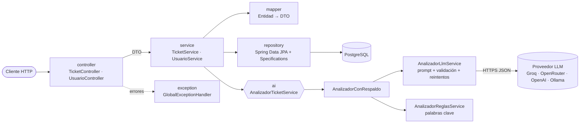
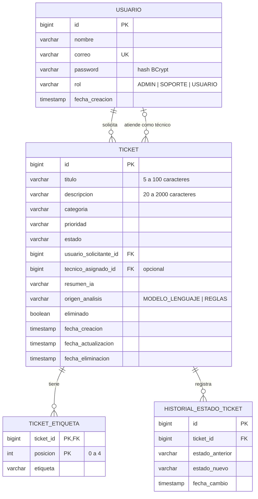
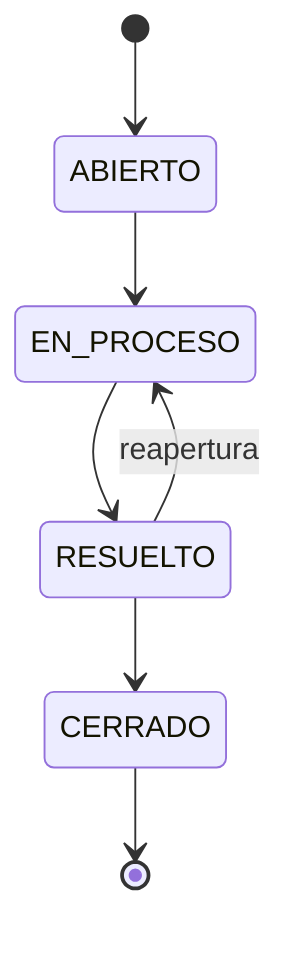

# Sistema Inteligente de Gestión de Tickets

API REST en Spring Boot para registrar y gestionar solicitudes de soporte técnico. Al crear un ticket, un
analizador de inteligencia artificial revisa el título y la descripción y sugiere:

- **Categoría**: HARDWARE, SOFTWARE, CONECTIVIDAD, ACCESOS u OTRO.
- **Prioridad**: BAJA, MEDIA, ALTA o CRITICA.
- **Resumen** de máximo 30 palabras.
- **Entre 1 y 5 etiquetas**.

El analizador usa un modelo de lenguaje (cualquier proveedor con API compatible con OpenAI: Groq, OpenRouter,
OpenAI, Ollama…). Si no hay API key o el modelo falla, usa un clasificador local por palabras clave. Así la
aplicación siempre funciona, también sin conexión a un proveedor.

## Contenido

1. [Tecnologías](#tecnologías)
2. [Arquitectura](#arquitectura)
3. [Modelo de datos](#modelo-de-datos)
4. [Requisitos de ejecución](#requisitos-de-ejecución)
5. [Variables de entorno](#variables-de-entorno)
6. [Crear la base de datos](#crear-la-base-de-datos)
7. [Ejecutar la aplicación](#ejecutar-la-aplicación)
8. [Endpoints](#endpoints)
9. [Ejemplos de solicitudes](#ejemplos-de-solicitudes)
10. [Manejo de errores](#manejo-de-errores)
11. [Estrategia de inteligencia artificial](#estrategia-de-inteligencia-artificial)
12. [Decisiones técnicas](#decisiones-técnicas)
13. [Pruebas](#pruebas)
14. [Limitaciones conocidas](#limitaciones-conocidas)

## Tecnologías

| Uso | Tecnología |
|---|---|
| Lenguaje y framework | Java 21, Spring Boot 4.1 (Spring Web MVC, Spring Data JPA, Bean Validation) |
| Base de datos | PostgreSQL 16, migraciones con Flyway |
| Inteligencia artificial | API `/chat/completions` compatible con OpenAI, consumida con `RestClient`; clasificador por reglas como alternativa |
| Documentación | springdoc-openapi (Swagger UI) y colección de Postman |
| Seguridad de contraseñas | BCrypt (`spring-security-crypto`) |
| Pruebas | JUnit 5, Mockito, MockMvc, `MockRestServiceServer`, PostgreSQL embebido (zonky) |
| Construcción y despliegue | Maven Wrapper, Dockerfile y Docker Compose |

## Arquitectura



| Paquete | Responsabilidad |
|---|---|
| `controller` | Endpoints REST. Reciben y devuelven DTO, nunca entidades JPA. |
| `service` | Reglas de negocio: ciclo de vida del ticket, asignación de técnicos, historial y métricas. |
| `repository` | Repositorios Spring Data JPA, filtros dinámicos (`TicketSpecifications`) y proyecciones de conteo. |
| `entity` | Entidades JPA y enumeraciones del dominio. |
| `dto` | Objetos de solicitud y respuesta, con sus validaciones. |
| `mapper` | Conversión de entidades a DTO. |
| `ai` | Analizadores intercambiables detrás de la interfaz `AnalizadorTicketService`. |
| `exception` | Excepciones personalizadas y `@RestControllerAdvice` con una respuesta de error única. |
| `config` | Selección del analizador, propiedades de IA, OpenAPI y cifrado de contraseñas. |

## Modelo de datos



El esquema está en [`V1__crear_esquema.sql`](src/main/resources/db/migration/V1__crear_esquema.sql). Incluye
claves foráneas, restricciones `CHECK` para cada enumeración y para la longitud del título y la descripción,
un correo único e índices para los filtros.

## Requisitos de ejecución

- **Java 21** o superior (`JAVA_HOME` apuntando al JDK).
- **PostgreSQL 14** o superior, o **Docker** para levantar todo con Docker Compose.
- No hace falta instalar Maven: el proyecto incluye Maven Wrapper (`mvnw` / `mvnw.cmd`).
- Opcional: API key de un proveedor de modelos de lenguaje, u Ollama instalado localmente.

## Variables de entorno

Copie `.env.example` como `.env` y ajuste los valores. La aplicación lee `.env` al iniciar y Docker Compose
también lo usa. El archivo `.env` está en `.gitignore`, así que ninguna clave se sube al repositorio.

| Variable | Valor por defecto | Descripción |
|---|---|---|
| `DB_URL` | `jdbc:postgresql://localhost:5432/tickets_db` | URL JDBC de PostgreSQL |
| `DB_USERNAME` | `postgres` | Usuario de la base de datos |
| `DB_PASSWORD` | `postgres` | Contraseña de la base de datos |
| `AI_MODE` | `auto` | `auto`: modelo si hay `AI_API_KEY`, si no reglas · `llm`: siempre el modelo · `reglas`: nunca llama al proveedor |
| `AI_BASE_URL` | `https://api.groq.com/openai/v1` | URL base del proveedor compatible con OpenAI |
| `AI_API_KEY` | *(vacía)* | API key del proveedor |
| `AI_MODEL` | `llama-3.3-70b-versatile` | Modelo a usar. Consulte la lista vigente de su proveedor. |
| `AI_FALLBACK` | `true` | Si el modelo falla, clasificar con reglas (`true`) o responder error 503/502 (`false`) |
| `AI_TIMEOUT` | `15s` | Tiempo límite de conexión y de respuesta del modelo |
| `AI_RETRIES` | `1` | Reintentos ante errores transitorios (timeout, 429, 5xx, respuesta inválida) |
| `AI_JSON_MODE` | `true` | Envía `response_format: json_object`; desactívelo si el modelo no lo soporta |
| `FLYWAY_LOCATIONS` | `classpath:db/migration,classpath:db/datos` | Use `classpath:db/migration` para no cargar los usuarios de demostración |

Ejemplos de configuración del proveedor:

| Proveedor | `AI_BASE_URL` | Notas |
|---|---|---|
| Groq | `https://api.groq.com/openai/v1` | Requiere `AI_API_KEY` |
| OpenRouter | `https://openrouter.ai/api/v1` | Requiere `AI_API_KEY`; `AI_MODEL` con el formato `proveedor/modelo` |
| OpenAI | `https://api.openai.com/v1` | Requiere `AI_API_KEY` |
| Ollama (local) | `http://localhost:11434/v1` | `AI_MODE=llm`, sin API key; descargue antes el modelo (`ollama pull llama3.1`) |

## Crear la base de datos

Solo hace falta crear la base vacía. Flyway crea las tablas al iniciar la aplicación y carga cinco usuarios de
demostración.

```sql
CREATE DATABASE tickets_db;
```

Desde la terminal:

```bash
psql -U postgres -c "CREATE DATABASE tickets_db;"
```

Usuarios de demostración (contraseña de todos: `Demo1234*`):

| id | Nombre | Rol |
|---|---|---|
| 1 | Laura Gómez | USUARIO |
| 2 | Carlos Pérez | USUARIO |
| 3 | Andrea Ruiz | ADMIN |
| 4 | Miguel Torres | SOPORTE |
| 5 | Sofía Ramírez | SOPORTE |

## Ejecutar la aplicación

### Opción 1: local con Maven Wrapper

```bash
cp .env.example .env
./mvnw spring-boot:run
```

En Windows (PowerShell o CMD) use `mvnw.cmd spring-boot:run`.

### Opción 2: Docker Compose (aplicación + PostgreSQL)

```bash
cp .env.example .env
docker compose up --build
```

Con Ollama en el equipo anfitrión, use `AI_BASE_URL=http://host.docker.internal:11434/v1`.

### Opción 3: sin PostgreSQL ni Docker (para revisar rápido)

```bash
./mvnw spring-boot:test-run
```

Levanta la aplicación con un PostgreSQL embebido. Las migraciones y los usuarios de demostración se cargan
igual, pero los datos se pierden al detenerla.

### Verificar

- API: `http://localhost:8080/api/tickets`
- Swagger UI: `http://localhost:8080/swagger-ui.html`
- OpenAPI (JSON): `http://localhost:8080/v3/api-docs`
- Colección de Postman: [`docs/postman/gestion-tickets-ia.postman_collection.json`](docs/postman/gestion-tickets-ia.postman_collection.json)

## Endpoints

| Método | Ruta | Descripción | Respuesta exitosa |
|---|---|---|---|
| `POST` | `/api/tickets` | Crea un ticket y lo clasifica con IA | `201` + cabecera `Location` |
| `GET` | `/api/tickets` | Consulta tickets con filtros, paginación y ordenamiento | `200` |
| `GET` | `/api/tickets/{id}` | Consulta un ticket con su análisis de IA | `200` |
| `PATCH` | `/api/tickets/{id}/estado` | Cambia el estado según el ciclo de vida | `200` |
| `PATCH` | `/api/tickets/{id}/asignar` | Asigna un técnico con rol SOPORTE | `200` |
| `DELETE` | `/api/tickets/{id}` | Elimina el ticket (eliminación lógica) | `204` |
| `GET` | `/api/tickets/{id}/historial` | Historial de cambios de estado | `200` |
| `GET` | `/api/tickets/metricas` | Totales por categoría, prioridad y estado | `200` |
| `POST` | `/api/usuarios` | Crea un usuario (contraseña cifrada con BCrypt) | `201` + cabecera `Location` |
| `GET` | `/api/usuarios?rol=SOPORTE` | Consulta usuarios, con filtro opcional por rol | `200` |
| `GET` | `/api/usuarios/{id}` | Consulta un usuario | `200` |

**Filtros de `GET /api/tickets`** (todos opcionales y combinables): `estado`, `categoria`, `prioridad`,
`usuarioId` (solicitante), `tecnicoId`, `texto` (busca en título y descripción, sin distinguir mayúsculas),
`page`, `size` (máximo 100) y `sort` (por ejemplo, `sort=fechaActualizacion,desc` o `sort=titulo,asc`). Por
defecto se ordena por `fechaCreacion` descendente, de 20 en 20.

**Ciclo de vida del estado:**



## Ejemplos de solicitudes

Crear un ticket:

```bash
curl -X POST http://localhost:8080/api/tickets \
  -H "Content-Type: application/json" \
  -d '{"titulo": "Problema con internet", "descripcion": "Desde esta mañana no puedo conectarme a internet y tengo una reunión importante en 20 minutos.", "usuarioId": 1}'
```

Respuesta (`201 Created`):

```json
{
  "id": 1,
  "titulo": "Problema con internet",
  "descripcion": "Desde esta mañana no puedo conectarme a internet y tengo una reunión importante en 20 minutos.",
  "categoria": "CONECTIVIDAD",
  "prioridad": "ALTA",
  "estado": "ABIERTO",
  "resumenIA": "Usuario sin conexión a internet antes de una reunión importante.",
  "etiquetasIA": ["internet", "conectividad", "reunión"],
  "origenAnalisis": "MODELO_LENGUAJE",
  "solicitante": { "id": 1, "nombre": "Laura Gómez" },
  "tecnicoAsignado": null,
  "fechaCreacion": "2026-07-30T19:30:00",
  "fechaActualizacion": "2026-07-30T19:30:00"
}
```

Otras operaciones:

```bash
# Filtrar
curl "http://localhost:8080/api/tickets?estado=ABIERTO&prioridad=ALTA"

# Consultar uno
curl http://localhost:8080/api/tickets/1

# Asignar técnico (el usuario 5 tiene rol SOPORTE)
curl -X PATCH http://localhost:8080/api/tickets/1/asignar -H "Content-Type: application/json" -d '{"tecnicoId": 5}'

# Cambiar estado
curl -X PATCH http://localhost:8080/api/tickets/1/estado -H "Content-Type: application/json" -d '{"estado": "EN_PROCESO"}'

# Eliminar
curl -X DELETE http://localhost:8080/api/tickets/1
```

## Manejo de errores

Todos los errores, incluidos los propios de Spring MVC (405, 415, rutas inexistentes), responden con la misma
estructura:

```json
{
  "timestamp": "2026-07-30T19:30:00",
  "status": 404,
  "error": "NOT_FOUND",
  "message": "No se encontró el ticket con id 15",
  "path": "/api/tickets/15"
}
```

Los errores de validación agregan el detalle por campo en `errores`:

```json
{
  "status": 400,
  "error": "BAD_REQUEST",
  "message": "La solicitud contiene datos inválidos",
  "path": "/api/tickets",
  "errores": [
    { "campo": "descripcion", "mensaje": "La descripción debe tener entre 20 y 2000 caracteres" },
    { "campo": "titulo", "mensaje": "El título es obligatorio" }
  ]
}
```

| Caso | Código |
|---|---|
| Datos obligatorios vacíos, longitudes, correo inválido | `400 BAD_REQUEST` (con `errores`) |
| Categoría, prioridad o estado inválidos (en el cuerpo o en los filtros); JSON mal formado; campo de ordenamiento inexistente | `400 BAD_REQUEST` (indica los valores permitidos) |
| Ticket, usuario o técnico inexistente | `404 NOT_FOUND` |
| Transición de estado no permitida, asignar técnico a un ticket RESUELTO o CERRADO, correo duplicado | `409 CONFLICT` |
| Técnico que existe pero no tiene rol SOPORTE | `422 UNPROCESSABLE_CONTENT` |
| Respuesta inválida del modelo, sin respaldo (`AI_FALLBACK=false`) | `502 BAD_GATEWAY` |
| Error de conexión o tiempo límite con el proveedor de IA, sin respaldo | `503 SERVICE_UNAVAILABLE` |
| Error no previsto | `500 INTERNAL_SERVER_ERROR` (sin detalles internos; queda en el log) |

## Estrategia de inteligencia artificial

La lógica de negocio depende solo de la interfaz sugerida en el enunciado:

```java
public interface AnalizadorTicketService {
    AnalisisTicketResponse analizar(String titulo, String descripcion);
}
```

`IaConfig` decide qué implementación se inyecta:

| Configuración | Analizador activo |
|---|---|
| `AI_MODE=reglas`, o `auto` sin `AI_API_KEY` | `AnalizadorReglasService` |
| `AI_MODE=llm`, o `auto` con `AI_API_KEY`, y `AI_FALLBACK=true` | `AnalizadorConRespaldo` (modelo → reglas si falla) |
| `AI_MODE=llm` y `AI_FALLBACK=false` | `AnalizadorLlmService` (los fallos se responden como 502/503) |

### Opción A: modelo de lenguaje (`AnalizadorLlmService`)

1. **Prompt** ([`PromptAnalisisTicket`](src/main/java/com/campuslands/tickets/ai/PromptAnalisisTicket.java)).
   Las instrucciones van en el mensaje de sistema: estructura JSON exacta, valores permitidos generados desde
   los enums (así no se desincronizan), criterio para cada categoría y prioridad, y límites de resumen y
   etiquetas. El ticket va en el mensaje de usuario entre `<ticket>` y `</ticket>`. El modelo tiene la
   instrucción de tratarlo como dato. Además, se eliminan esas marcas del texto del usuario, lo que mitiga la
   inyección de instrucciones dentro de la descripción.
2. **Respuesta estructurada.** Se pide `response_format: json_object` (desactivable con `AI_JSON_MODE=false`
   para modelos que no lo soporten) y temperatura 0. Al leer la respuesta se toma el primer objeto JSON del
   contenido, así que también se aceptan respuestas envueltas en bloques de código.
3. **Validación** ([`ValidadorAnalisisIa`](src/main/java/com/campuslands/tickets/ai/ValidadorAnalisisIa.java)).
   - La categoría y la prioridad deben pertenecer al catálogo. Se toleran tildes y mayúsculas ("Crítica"),
     pero no valores inventados.
   - El resumen se recorta a 30 palabras.
   - Las etiquetas se normalizan (minúscula, sin `#`, sin repetir) y se limitan a 5.
   - Sin etiquetas o sin resumen, la respuesta es inválida.
4. **Resiliencia.**
   - Tiempo límite configurable.
   - Reintentos con espera creciente ante timeout, error de conexión, HTTP 429/5xx o respuesta inválida.
   - Los errores 401/403/400 no se reintentan.
5. **Respaldo.** Si al final el modelo falla, `AnalizadorConRespaldo` clasifica con reglas y el ticket queda con
   `origenAnalisis = REGLAS`, para que se sepa qué analizador lo clasificó.

Se usó `RestClient` contra el contrato `/chat/completions` en lugar de un SDK específico. Ese contrato lo
comparten Groq, OpenRouter, OpenAI y Ollama, así que cambiar de proveedor es solo cambiar variables de entorno.

### Opción B: clasificador por reglas (`AnalizadorReglasService`)

- **Categoría:** suma los pesos de las palabras clave de cada categoría y gana la de mayor puntaje. Ejemplos:
  "internet", "wifi" o "conectarme" para CONECTIVIDAD; "contraseña" o "permiso" para ACCESOS; "pantalla" o
  "teclado" para HARDWARE; "aplicación" o "error" para SOFTWARE. Sin coincidencias, OTRO.
- **Prioridad:** reglas en orden.
  1. CRITICA: "producción detenida", "todos los usuarios", "virus"…
  2. BAJA explícita: "no es urgente", "sin prisa"…
  3. ALTA: "urgente", "no puedo trabajar", "en 20 minutos"…
  4. BAJA: "consulta", "duda"…

  Si ninguna coincide, MEDIA.
- **Coincidencias:** se comparan palabras completas, sin tildes y sin distinguir mayúsculas. Así "red" no
  coincide con "credenciales".
- **Resumen y etiquetas:** el resumen es la primera oración de la descripción (máximo 30 palabras). Las
  etiquetas salen de las palabras clave encontradas.

## Decisiones técnicas

- **Eliminación lógica.** Un ticket de soporte es un registro de auditoría: se marca `eliminado = true` con su
  `fecha_eliminacion` y se conserva junto con su historial. `@SQLRestriction` lo excluye de todas las consultas
  de JPA, así que para la API responde 404, igual que uno que nunca existió.
- **El análisis se hace antes de guardar.** La llamada al modelo puede tardar segundos, así que se ejecuta fuera
  de la transacción. Después, el ticket se inserta una sola vez ya clasificado. Así no se retiene una conexión
  de base de datos esperando al proveedor, y nunca queda un ticket a medio clasificar si el análisis falla.
- **Ciclo de vida explícito.** Las transiciones permitidas están en `EstadoTicket`. Un estado que no existe es un
  400 (dato inválido). Una transición no permitida es un 409 (conflicto con el estado actual). Cada cambio,
  incluido el estado inicial, queda en `historial_estado_ticket`.
- **404 frente a 422 en la asignación.** Si el técnico no existe, 404. Si existe pero no tiene rol SOPORTE, 422:
  la solicitud es válida en su forma, pero viola una regla de negocio. Un ADMIN tampoco se puede asignar, porque
  el enunciado dice "solo SOPORTE".
- **No se puede asignar técnico a tickets RESUELTO o CERRADO** (409). Asignar no cambia el estado: el cambio de
  estado es una acción explícita del técnico.
- **Enums como `VARCHAR` con `CHECK`** en lugar de tipos `ENUM` nativos de PostgreSQL. Funcionan directamente con
  `@Enumerated(STRING)` y agregar un valor solo requiere una migración simple.
- **Etiquetas en tabla propia** (`ticket_etiqueta`, con `@ElementCollection` y posición). Quedan normalizadas,
  conservan su orden y se pueden consultar con SQL. Se cargan en lote (`default_batch_fetch_size`) para evitar
  N+1 en los listados.
- **Endpoint de usuarios.** El enunciado no lo exige, pero el ticket necesita un `usuarioId` existente y se pide
  validar el correo. Las contraseñas se guardan con BCrypt y nunca se devuelven.
- **Flyway con `ddl-auto=validate`.** El esquema lo define la migración versionada. Hibernate solo valida que las
  entidades coincidan con él. Los usuarios de demostración son una migración repetible e idempotente en
  `db/datos`, que se puede omitir con `FLYWAY_LOCATIONS`.
- **Fechas** con el formato del enunciado (`yyyy-MM-dd'T'HH:mm:ss`), en la zona horaria del servidor.

## Pruebas

```bash
./mvnw test
```

Las pruebas no necesitan Docker ni un PostgreSQL instalado: la prueba de integración levanta un PostgreSQL
embebido (zonky). Tampoco llaman a un proveedor de IA real, porque el modelo se simula con
`MockRestServiceServer` o con mocks.

| Prueba | Qué valida |
|---|---|
| `TicketServiceImplTest` (Mockito) | Creación de ticket con análisis de IA, ticket inexistente, técnico inexistente o sin rol SOPORTE, asignación a ticket cerrado, transiciones de estado válidas e inválidas, eliminación lógica |
| `TicketControllerTest` (MockMvc) | Códigos HTTP, cabecera `Location`, formato de fechas, validaciones por campo, estructura de error, enums inválidos en cuerpo y filtros, 409 y 422 |
| `AnalizadorLlmServiceTest` | Prompt y cuerpo enviados al proveedor, lectura del JSON, respuestas inválidas, reintentos, 401 sin reintento, timeout |
| `ValidadorAnalisisIaTest` | Normalización y rechazo de categorías o prioridades fuera del catálogo, límites de resumen y etiquetas |
| `AnalizadorReglasServiceTest` | Clasificación del ejemplo del enunciado, categorías, prioridades, palabras completas, límites |
| `AnalizadorConRespaldoTest` | Uso del respaldo cuando el modelo falla |
| `IaConfigTest` | Selección del analizador según `AI_MODE`, API key y respaldo; clasificación con reglas cuando el proveedor real no responde |
| `EstadoTicketTest` | Matriz de transiciones del ciclo de vida |
| `TicketApiIntegracionTest` | Flujo completo contra PostgreSQL real: migraciones, filtros, búsqueda, ordenamiento, historial, eliminación lógica, métricas y usuarios |

## Limitaciones conocidas

- **Sin autenticación ni autorización.** JWT y permisos por rol son opcionales en el enunciado y no se
  implementaron, así que cualquier cliente puede invocar todos los endpoints. Si se agregan, el solicitante
  debería tomarse del token y no del `usuarioId` del cuerpo.
- **El clasificador por reglas es aproximado.** Depende de las palabras clave definidas, no entiende negaciones
  complejas ni sinónimos fuera de la lista, y su resumen es extractivo (la primera oración), no una redacción
  nueva.
- **El modelo de lenguaje no es determinista.** Aun con temperatura 0, la misma descripción puede recibir
  clasificaciones distintas entre modelos o versiones. La validación garantiza el formato, no el criterio.
- **La llamada al modelo es síncrona.** Crear un ticket tarda lo que tarde el proveedor (hasta `AI_TIMEOUT` por
  intento, más los reintentos). No hay caché de análisis ni procesamiento asíncrono.
- **Ordenar por `prioridad`, `categoria` o `estado` es alfabético**, no por severidad, porque se guardan como
  texto. Para ver los tickets más graves, filtre por prioridad (`prioridad=CRITICA`).
- **La clasificación de la IA no se puede corregir manualmente.** No hay un endpoint para cambiar la categoría o
  la prioridad sugeridas.
- **Las fechas se guardan sin zona horaria** (`TIMESTAMP`), en la hora local del servidor.
